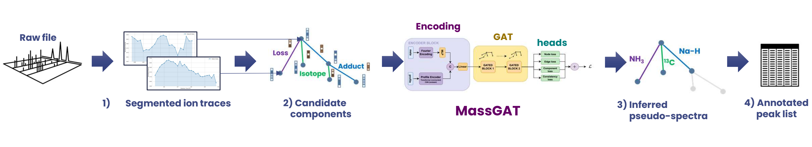

# MassGAT

**MassGAT** is a graph-based collective learning framework for untargeted detection and annotation of LC-HRMS data. By modeling LC-MS files as hierarchical graphs where nodes represent ion traces and edges represent chemical relationships (isotopes, adducts, dimers), MassGAT performs simultaneous peak detection and grouping, leveraging analytical redundancy to rescue valid, low-intensity signals.




## Table of Contents
- [Requirements](#requirements)
- [Installation](#installation)
  - [Option A: HPC / Slurm (Recommended)](#option-a-hpc--slurm-recommended)
  - [Option B: Local Workstation](#option-b-local-workstation-linuxmacoswindows)
- [Usage](#usage)
  - [Interactive Tutorial](#interactive-tutorial)
  - [Command Line Interface (CLI)](#command-line-interface-cli)
- [Repository Structure](#repository-structure)
- [Citation](#citation)

## Requirements

* **Servers:** Singularity or Apptainer.
* **Local :** Miniforge or Miniconda + R


## Installation (Local)

First, clone the repository:
```bash
git clone https://github.com/odisce/MassGAT.git
cd MassGAT
```


### Option A: Singularity / Docker

A faire quand on aura l'image sur dockerhub


### Option B : Local (Linux/MacOS/Windows)

Open the Miniforge/Miniconda terminal to run the setup. If you wish to use a standard terminal on Windows, run :

```bash
conda init cmd.exe
```

in the Miniforge/Miniconda terminal, then restart the terminal.


1. Create the environment and activate it:
```bash
conda create --name massgat_env python=3.10 --channel conda-forge --override-channels -y
conda activate massgat_env
```

2. Intsall PyTorch & PyTorch Geometric

For CPU-only, replace cu118 with cpu in the following commands:
```bash
pip install torch==2.1.0 torchvision --index-url [https://download.pytorch.org/whl/cu118](https://download.pytorch.org/whl/cu118)
pip install torch-scatter torch-sparse torch-cluster -f [https://data.pyg.org/whl/torch-2.1.0+cu118.html](https://data.pyg.org/whl/torch-2.1.0+cu118.html)
```

3. Install MassGAT and its dependencies:
```bash
pip install -e .
```

4. Install R Dependencies (IonShed & XCMS) :
```bash
Rscript src/massgat/r_scripts/install_packages.R
```


## Configuration
MassGAT allows you to tune the analytical pipeline without modifying the source code via the config.yaml file located in the root directory. Key sections include:

1. Peak Picking (peak_picking): Configure standard LC-MS parameters (ppm, rttol) passed directly to the IonShed segmentation algorithm.
2. Graph (graph): Adjust rt_window and mz_tolerance to define how nodes are linked geographically in the dataset.
3. Thresholds (thresholds): Tune correlation thresholds (isotope_corr, adduct_corr) to make chemical edge assignments more or less strict. Lowering these will yield denser graphs.


## Usage

### Interactive Tutorial

We provide an interactive tool using Jupyter Notebook to demonstrate the MassGAT pipeline (Ionshed segmentation, graph construction, inference, and component vizualization) on a test file.

1. Create a directory in the `data` folder with your project name, create a `mzml` subdirectory, and place your .mzML (or .mzXML) files inside it. For testing, you can also use the provided test file in the `data/test` folder.

2. Install Jupyter integrations in `massgat_env`: ```bash conda install -c conda-forge jupyter rpy2 -y```

3. Open the `massgat.ipynb` notebook, select the `massgat_env` kernel, and follow the instructions in each cell to run the pipeline.

4. The results will be saved in the `results` subfolder of your project directory, and you can explore the output tables and visualizations directly in the notebook.


### Command Line Interface

For batch processing or execution on remote servers, you can run the pipeline sequentially from the terminal.


**Data Preparation**
First, set up your input directory. Create a folder named `data/mzml` in the root of your repository and place your raw `.mzML` or `.mzXML` files inside it. Your structure should look like this:
```text
MassGAT/
└── data/
    └── project_name/
        └── mzml/
            ├── sample_01.mzML
            └── sample_02.mzML
```

**1. Trace Segmentation (R)**
Run the IonShed script to extract peaks and Region of Interest (ROI) signals into `.feather` format. If you create a new project folder, replace `test` with your project folder path in the command below.
```bash
Rscript scripts/ionshed_batch_processing.R data/test/mzml data/test/ionshed_output
```


**2. Graph Construction (Python)**
Build PyTorch Geometric graphs (`.pt`) from the extracted `.feather` tables.
```bash
python scripts/build_graphs.py --input_dir  data/test/ionshed_output --output_dir data/test/graphs --ionization_mode positive
```

**3. Model Inference (Python)**
Pass the constructed graphs through the trained MassGAT model. This step evaluates probabilities, groups peaks into chemical components, and optionally annotates them.
The `--with_top_annotations` flag can be used to obtain the top 5 annotations for each component suggested by the annotation heuristic. By default, only peaks with a probability above 0.5 are kept, but you can adjust this threshold using the `--min_node_prob` argument.

```bash
python scripts/predict.py --folder data/test/graphs --data_type real --weights weights/model_positive.pth --model_type iterative --output_dir data/test/results --min_node_prob 0.5 --with_top_annotations
```


## Training

To train MassGAT on a custom or synthetic dataset, use the `train.py` script. The script uses command-line arguments to configure hyperparameters and relies on MLflow to track experiments and metrics.

```bash
python scripts/train.py --use_synthetic --synthetic_path data/synthetic_dataset
```


## Citation