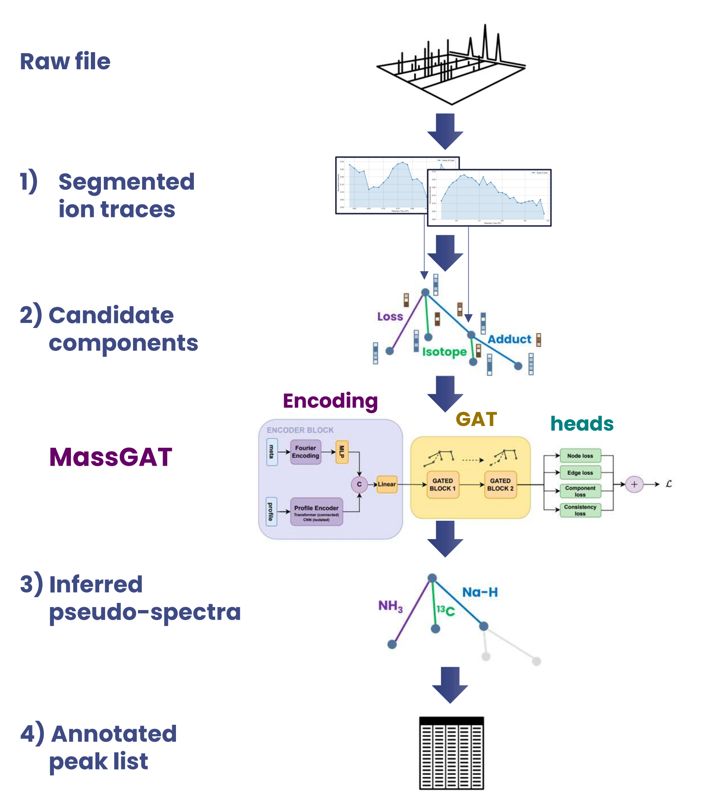

# MassGAT

**MassGAT** is a graph-based collective learning framework for untargeted detection and annotation of LC-HRMS data. By modeling LC-MS files as hierarchical graphs where nodes represent ion traces and edges represent chemical relationships (isotopes, adducts, dimers), MassGAT performs simultaneous peak detection and grouping, leveraging analytical redundancy to rescue valid, low-intensity signals.




## Table of Contents
- [Requirements](#requirements)
- [Installation](#installation)
  - [Option A: HPC / Slurm (Recommended)](#option-a-hpc--slurm-recommended)
  - [Option B: Local Workstation](#option-b-local-workstation-linuxmacoswindows)
- [Usage](#usage)
  - [Interactive Tutorial](#interactive-tutorial)
  - [Command Line Interface (CLI)](#command-line-interface-cli)
- [Repository Structure](#repository-structure)
- [Citation](#citation)

## Requirements

* **Servers:** Singularity or Apptainer.
* **Local :** [Miniforge](https://github.com/conda-forge/miniforge) or Miniconda.


## Installation (Local)

First, clone the repository:
```bash
git clone https://github.com/odisce/MassGAT.git
cd MassGAT
```


### Option A: Singularity / Docker


### Option B : Local (Linux/MacOS/Windows)

```bash
conda create --name massgat_env python=3.10 --channel conda-forge --override-channels -y
conda activate massgat_env
```
